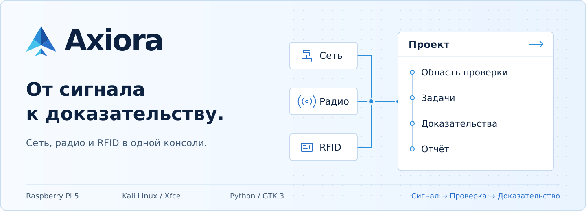
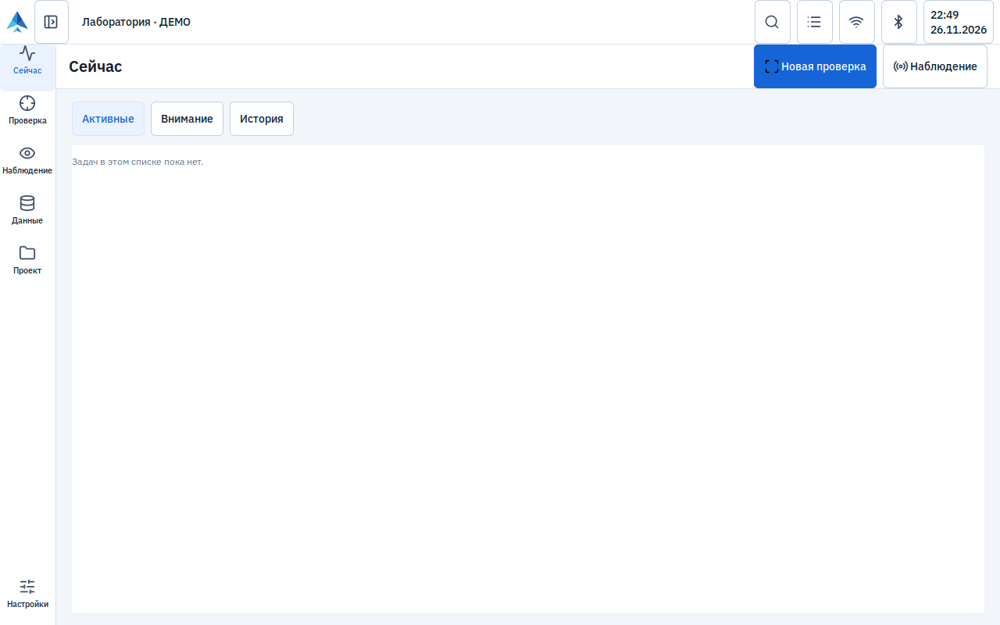
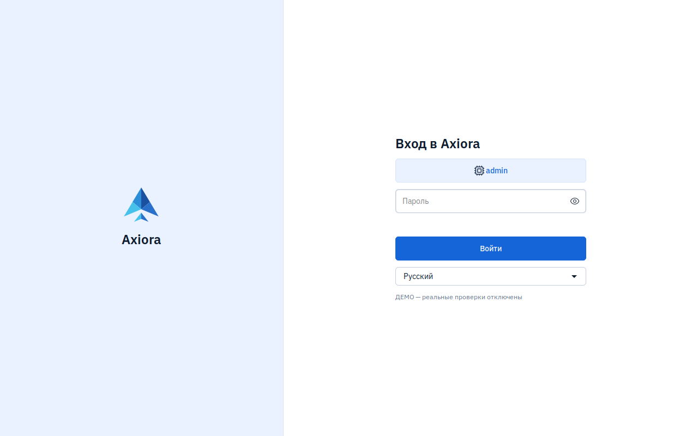
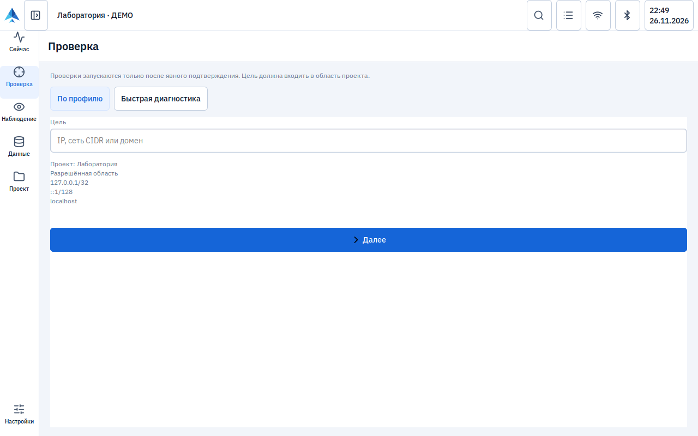
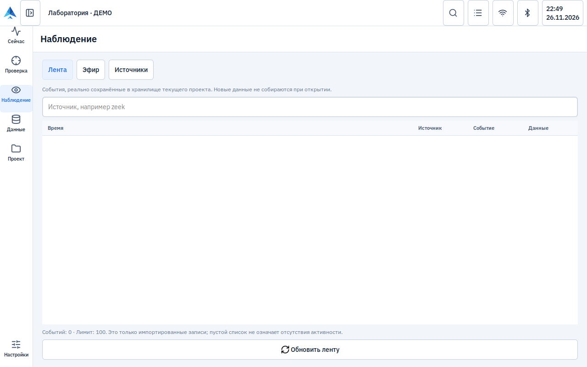
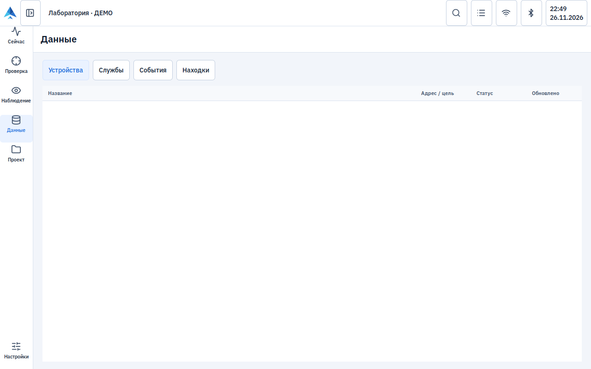
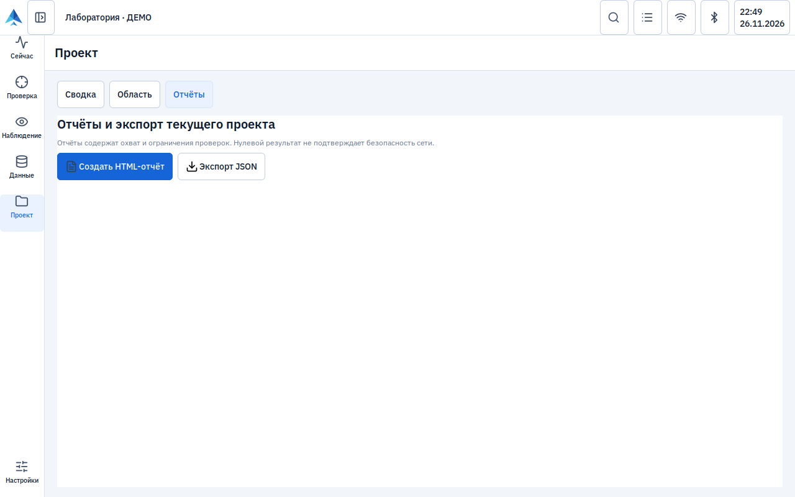
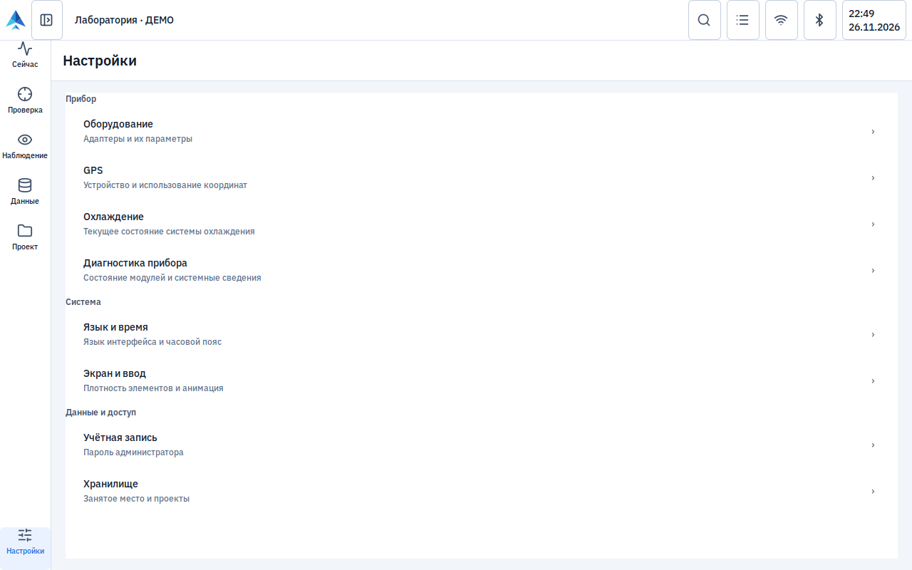

<p align="center">
  
</p>

<p align="center">
  <strong>Одна консоль для сети, радио и RFID.</strong>
</p>

<p align="center">
  <kbd>Python</kbd>&nbsp; <kbd>GTK 3</kbd>&nbsp; <kbd>Kali Linux / Xfce</kbd>&nbsp; <kbd>Raspberry Pi 5</kbd>
</p>

<p align="center">
  <a href="#быстрый-запуск">Запустить демо</a> ·
  <a href="#путь-по-приложению">Посмотреть интерфейс</a> ·
  <a href="docs/guide.md">Полное руководство</a> ·
  <a href="#возможности-и-границы">Возможности и границы</a>
</p>

---

Axiora объединяет аппаратные модули, сетевые инструменты и результаты проверок в настольном приложении. Интерфейс рассчитан на Raspberry Pi 5 и сенсорный экран от **800×480**. На обычном Linux-компьютере можно использовать сетевые инструменты без GPIO.

Рабочий процесс строится вокруг проекта: определить область проверки, запустить задачу, сохранить исходные результаты и собрать отчёт с доказательствами.



*Актуальная нативная GTK-сборка, 1280×800. Снимки сделаны в деморежиме с пустым тестовым проектом: сетевые проверки и оборудование не запускались.*

> Галерея показывает новую рабочую сборку. Код в `main` пока использует предыдущий интерфейс; команды быстрого запуска ниже относятся к опубликованному коду.

<details>
<summary><strong>Экран входа</strong></summary>



</details>

## Путь по приложению

**Область проверки → Задача → Результат → Отчёт**

| Шаг | Где | Что происходит |
| :--- | :--- | :--- |
| **01 / Задать область** | Проект → Область | Указать допустимые цели проверки. |
| **02 / Проверить** | Проверка | Выбрать профиль или инструмент и подтвердить запуск. |
| **03 / Проследить** | Сейчас / Наблюдение | Посмотреть состояние задач и сохранённые события. |
| **04 / Разобрать** | Данные | Открыть устройства, службы, события и находки проекта. |
| **05 / Сохранить** | Проект → Отчёты | Создать HTML-отчёт или экспортировать JSON. |

### 01. Запустить проверку

В разделе «Проверка» укажите цель из области проекта, затем выберите профиль или перейдите к быстрой диагностике. Запуск требует подтверждения. Экран «Сейчас» показывает активные задачи, задачи, требующие внимания, и историю проекта.



<details>
<summary><strong>Наблюдение: лента, эфир и источники</strong></summary>

Лента показывает сохранённые события проекта с фильтром по источнику. Открытие страницы не запускает сбор данных.



</details>

---

### 02. Разобрать результаты

Раздел «Данные» объединяет устройства, службы, события и находки выбранного проекта. На снимке показан пустой проект до первых проверок.



---

### 03. Сохранить отчёт

Во вкладке «Проект → Отчёты» доступны **HTML-отчёт и экспорт JSON**. Отчёт относится к выбранному проекту и содержит охват и ограничения проверок.



<details>
<summary><strong>Настройки прибора и системы</strong></summary>

Оборудование, GPS, охлаждение и диагностика находятся в настройках. Здесь же доступны язык, экран и ввод, учётная запись и хранилище. Кнопки Wi-Fi и Bluetooth вынесены в верхнюю панель.



</details>

---

## Возможности и границы

| Направление | Что есть в проекте | Что необходимо |
| :--- | :--- | :--- |
| **Сеть и Web / API** | Адаптеры сетевой диагностики, Nmap, HTTP/OpenAPI и других инструментов; задачи, журнал и сравнение результатов. | Зависимости выбранного адаптера, права и заданная область проверки. |
| **PCAP и измерения** | Анализ сохранённого трафика и интеграции сетевых измерений. | Соответствующие CLI-инструменты; для захвата - доступ к интерфейсу. |
| **RFID** | MFRC522: UID и блоки MIFARE Classic с известным ключом. RDM6300: чтение UART-кадров. | Совместимая карта, модуль, корректные питание и подключение. |
| **Радио** | nRF24L01: пакетный обмен. CC1101: пакетные режимы и приём OOK-импульсов. | Совпадающие параметры протокола, подходящий модуль и антенна. |
| **GPS, Ethernet, сенсор** | NEO-6M/NMEA; W5500 через Linux; XPT2046 через `ads7846` и libinput. | Рабочие драйверы, права на устройства и согласованный аппаратный профиль. |
| **Проекты и доказательства** | Область проверки, история задач, находки, исходные артефакты, отчёты и CLI без GTK. | Локальное хранилище; дополнительные пакеты для отдельных форматов. |

**Статус:** программные интеграции реализованы; работа конкретной сборки Pi 5, драйверов Kali и подключённых модулей требует проверки на стенде. Отсутствующее устройство, инструмент или права отображаются как ошибка.

Аналитика использует эвристические правила. Эмуляция RFID, универсальное декодирование радиопротоколов и передача сырых OOK-импульсов не реализованы. Успешное завершение передачи не подтверждает получение пакета другим устройством.

[Подробная матрица поддержки](docs/guide.md#возможности-и-границы) · [Каталог программных модулей](docs/guide.md#каталог-программных-модулей)

## Быстрый запуск

Для знакомства достаточно Linux с графическим сеансом и GTK 3. Raspberry Pi и внешние модули для демо не нужны.

```sh
# Kali / Debian: минимальные зависимости интерфейса
sudo apt update
sudo apt install git python3-gi gir1.2-gtk-3.0 python3-cairo python3-gi-cairo

git clone https://github.com/TeemFlash/axiora.git
cd axiora
python3 axiora.py --demo
```

Первый вход: **`admin` / `admin`**. Демо хранит историю, настройки и учётную запись отдельно от рабочего режима.

Для рабочего запуска установите зависимости нужных модулей по [руководству](docs/guide.md#запуск), затем:

```sh
python3 axiora.py                     # рабочий режим
python3 axiora.py --fullscreen        # весь экран
python3 axiora.py --size=1024x600      # выбранный размер окна
python3 axiora.py --diagnose          # диагностика без GUI и GTK
python3 axiora_cli.py --help          # CLI без GTK
```

В рабочем режиме при первом входе потребуется сменить начальный пароль: **минимум 10 символов**. Запускайте GUI от обычного пользователя; права на устройства настраиваются отдельно.

> **Для сборки на Pi 5:** перед применением GPIO и Device Tree сверяйте профиль с реальной распиновкой. Конфигурация в репозитории относится к описанной в руководстве схеме и не подтверждает совместимость любой комбинации модулей.

[Подключение Raspberry Pi 5](docs/guide.md#подключение-raspberry-pi-5) · [Установка инструментов](docs/guide.md#установка-инструментов) · [Устранение проблем](docs/guide.md#устранение-проблем)

## Как устроен проект

```text
axiora.py                 GTK-приложение, события и демонстрация
axiora_pages.py           Аппаратные страницы интерфейса
axiora_hardware.py        Драйверы и конфигурация модулей
axiora_protocols.py       Профили и разбор радиопротоколов
axiora_workbench.py       Выполнение задач и реестр инструментов
axiora_workbench_pages.py Интерфейс задач, проектов и находок
axiora_cli.py             Работа с задачами без GTK
axiora_projects.py        Хранение проектов, задач и доказательств
axiora_reports.py         Отчёты проектов
hardware/                 Device Tree и правила доступа
examples/                 Примеры профилей и входных файлов
tests/                    Модульные и GTK-проверки
docs/                     Руководство и снимки интерфейса
```

Задачи выполняются вне GTK-потока. История и данные проектов хранятся локально в SQLite; исходные результаты сохраняются рядом с задачами. Сетевые инструменты подключены через адаптеры, а CLI использует тот же механизм выполнения.

<details>
<summary><strong>Разработчику: проверки и расширение</strong></summary>

Проверки без физического оборудования:

```sh
python3 -m unittest discover -s tests -p 'test_*.py'
python3 -m compileall -q axiora*.py tests
sh -n install-desktop.sh
```

GTK-проверки запускаются в графическом сеансе:

```sh
python3 tests/smoke_gui.py
python3 tests/smoke_workbench.py
```

[Workflow проверок](.github/workflows/checks.yml) · [Расширение адаптеров](docs/guide.md#расширение-адаптеров-разработчиком) · [Полная инструкция для разработки](docs/guide.md#проверка-разработки)

</details>

## Дальше

| Собрать устройство | Провести проверку |
| :--- | :--- |
| [Подключение, Device Tree и права](docs/guide.md#подключение-raspberry-pi-5) | [Проект, задачи, находки и отчёт](docs/guide.md#инструменты-полный-рабочий-цикл) |

| Работать без экрана | Разобраться с ограничениями |
| :--- | :--- |
| [Командная строка](docs/guide.md#командная-строка-без-gtk) и [исполнитель по SSH](docs/guide.md#удалённый-исполнитель-ssh) | [Хранение, резервные копии и границы](docs/guide.md#хранение-резервная-копия-и-ограничения) |

---

<p align="center"><strong>Axiora</strong><br><sub>Сигнал → Проверка → Доказательство</sub></p>
